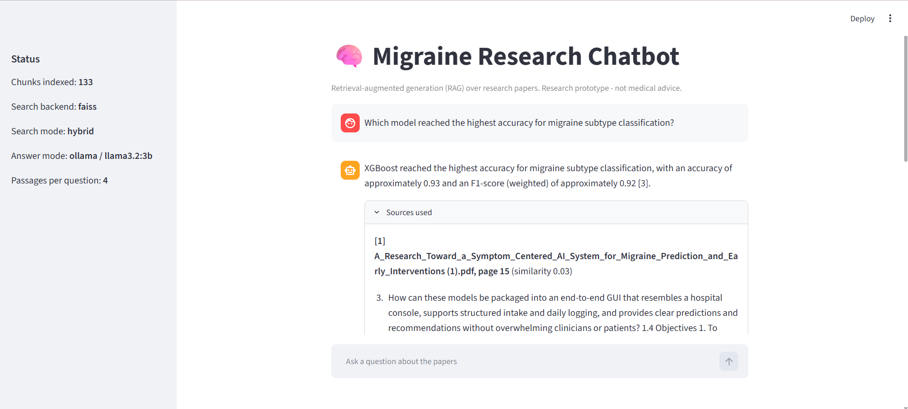
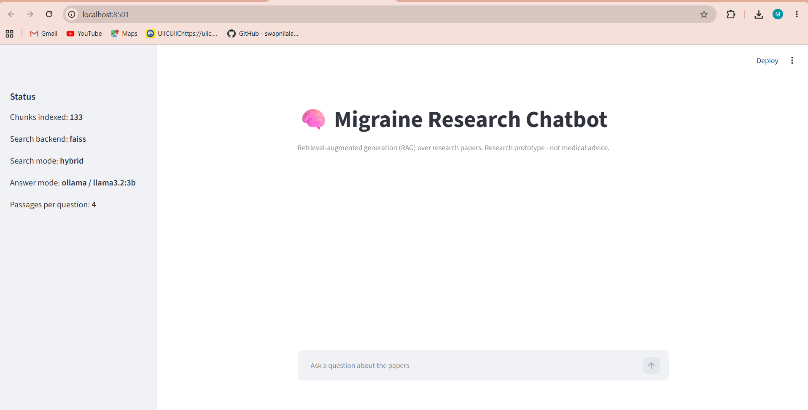

# Migraine Research Chatbot (RAG)

A question-answering chatbot over migraine research papers. I ask a question, it finds the most relevant passages in my papers, and a local language model writes an answer that cites those passages. Everything runs on my own laptop with free tools, with no API key and no paid service.




> **Research prototype.** It is not a medical tool and gives no medical advice. Answers can still contain mistakes, which is why every answer shows its sources.

## Why I built it
My M.Tech project was a migraine prediction system (NeuroCare). I wanted a way to ask questions about my own papers and get answers with sources, and I wanted to learn retrieval-augmented generation (RAG) properly by building each step myself and measuring how well the search works, instead of wrapping a framework around it.

## How it works
```
PDFs -> read text -> split into overlapping chunks -> embed -> FAISS index        (python ingest.py)

question -> retrieve top 4 chunks (dense / keyword / hybrid) -> prompt Llama 3.2
         -> answer with citations [1], [2] + the source passages                  (python app.py / chat_cli.py)
```

1. **Reading and chunking.** `pypdf` extracts text page by page. I split it into sentence-aware chunks of about 900 characters with 150 characters of overlap, and keep the source file and page for every chunk.
2. **Embeddings and vector search.** Chunks are embedded with `sentence-transformers/all-MiniLM-L6-v2` and stored in a FAISS index (cosine similarity).
3. **Keyword search.** A TF-IDF index (scikit-learn, 1-2 word n-grams) finds exact terms and numbers that embeddings tend to miss.
4. **Hybrid search.** I run both searches and merge the two rankings with Reciprocal Rank Fusion. The search mode is a single setting in `rag/config.py`.
5. **Answering.** The prompt gives Llama 3.2 (3B, running locally through Ollama) only the retrieved passages, asks for citations, and tells it to say "I could not find this in the provided papers" when the answer is missing.
6. **Interface.** A Streamlit chat page with an expandable "Sources used" panel, plus a command-line chat.

## Results
I measured retrieval, not just the final answers. I wrote 20 questions about my two papers (133 chunks in total). For each question I listed phrases that prove a retrieved passage contains the answer. A question counts as a hit if one of the top 4 retrieved chunks contains one of those phrases (hit@4).

| Search mode | hit@4 |
|---|---|
| Dense (embeddings only) | 12/20 = **60%** |
| Keyword (TF-IDF) | 14/20 = **70%** |
| Hybrid (merged with Reciprocal Rank Fusion) | 14/20 = **70%** |

What I learned from this:
- Embeddings alone did worst. Many of my questions contain exact terms and numbers ("64 hidden units", "AUC of 0.57"), and the small embedding model matches meaning better than exact wording.
- Hybrid matched keyword search here, and I use it as the default because real questions are often paraphrased, where embeddings help.
- Running `python evaluate.py --verbose` prints the four passages retrieved for every miss, which showed me whether the search or my accepted phrases were at fault. That led me to add one alternative phrase to the question set after my first run.

## Limitations
- **Small test set.** 20 questions over 2 papers, so each question is worth 5 percentage points. Treat the numbers as indicative.
- **Question wording.** I wrote the questions using the papers' own vocabulary, which favours keyword search.
- **Small local model.** Llama 3.2 3B sometimes stretches a passage into an unsupported claim. For example, it once explained SMOTE as a way to avoid overfitting when my paper says it addresses class imbalance (the paper's answer was dropout and early stopping). I check "Sources used" on every answer.
- **PDF text only.** Tables and figures are not understood well, and scanned PDFs need selectable text.
- **Evaluation covers retrieval.** I have not built an automatic score for answer quality.

## Tech stack
Python 3.13, sentence-transformers (Hugging Face), FAISS, scikit-learn (TF-IDF), pypdf, Ollama with Llama 3.2 (3B), Streamlit, pytest.

## Project structure
```
app.py                  Streamlit chat app
chat_cli.py             command-line chat
ingest.py               build the index from the PDFs
evaluate.py             hit@k evaluation (dense / keyword / hybrid, --compare, --verbose)
check_eval_questions.py checks that the evaluation phrases exist in the index
eval_questions.json     the 20 evaluation questions
rag/
  loader.py             reads PDF / TXT files
  chunking.py           overlapping sentence-aware chunks
  embeddings.py         sentence-transformers embedder
  store.py              FAISS index + TF-IDF + hybrid search
  prompt.py             the prompt sent to the model
  llm.py                Ollama / OpenAI-compatible / Anthropic client
  evaluation.py         hit@k metric
  config.py             settings (chunk size, TOP_K, SEARCH_MODE)
tests/                  26 pytest tests
```

## Run it yourself (Windows)
**Prerequisites:** Python 3.11 to 3.13, and [Ollama](https://ollama.com).

1. Pull the model once:
   ```
   ollama pull llama3.2:3b
   ```
2. Create an environment and install the packages:
   ```
   python -m venv .venv
   .venv\Scripts\python.exe -m pip install -r requirements.txt
   ```
3. Create your settings file by copying `.env.example` to `.env`. The default uses Ollama.
4. Put the PDFs you want to ask about in `data\papers\`. I do not include my papers in this repository.
5. Build the index:
   ```
   .venv\Scripts\python.exe ingest.py
   ```
6. Start the chat page:
   ```
   .venv\Scripts\python.exe -m streamlit run app.py
   ```
   or chat in the terminal with `.venv\Scripts\python.exe chat_cli.py`.

### Evaluate retrieval
Replace the questions in `eval_questions.json` with your own (each needs `expected_phrases`), then:
```
.venv\Scripts\python.exe check_eval_questions.py
.venv\Scripts\python.exe evaluate.py --compare
.venv\Scripts\python.exe evaluate.py --verbose
```

### Run the tests
```
.venv\Scripts\python.exe -m pip install -r requirements-dev.txt
.venv\Scripts\python.exe -m pytest -v
```

## Configuration
In `.env` (see `.env.example`) I can switch the answering model without changing code:
- `LLM_PROVIDER=ollama` (default): a free model on my own computer.
- `LLM_PROVIDER=openai_compatible`: any OpenAI-style API (for example Groq, Google Gemini or OpenRouter), with `LLM_BASE_URL`, `LLM_API_KEY` and `LLM_MODEL`.
- `LLM_PROVIDER=anthropic`: Claude, with `ANTHROPIC_API_KEY`.

In `rag/config.py`, `SEARCH_MODE` can be `"dense"`, `"keyword"` or `"hybrid"`, and `TOP_K`, `CHUNK_SIZE` and `CHUNK_OVERLAP` control retrieval.

## Author
Mohini Lawande, M.Tech in Data Science (SPPU) | [LinkedIn](https://www.linkedin.com/in/mohini-lawande)
